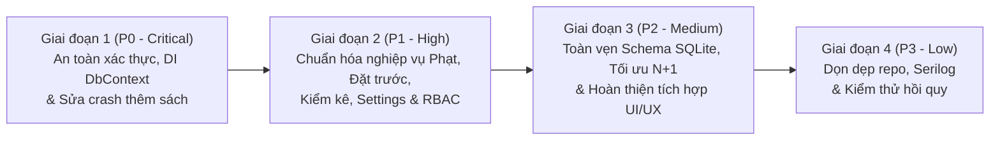

# KẾ HOẠCH KHẮC PHỤC LỖI HỆ THỐNG (REMEDIATION & FIX PLAN)

Tài liệu này lập kế hoạch chi tiết theo từng giai đoạn để khắc phục toàn bộ **17 lỗi (`BUG-001` → `BUG-017`)** đã được phát hiện trong báo cáo `SYSTEM_AUDIT_REPORT.md`, tuân thủ nghiêm ngặt chuẩn kiến trúc của dự án (`library-desktop-standards`).

---

## Tổng quan Lộ trình Khắc phục

---

## GIAI ĐOẠN 1: XỬ LÝ CÁC LỖI NGHIÊM TRỌNG (P0 – CRITICAL)

**Mục tiêu:** Chặn lỗ hổng bỏ qua đăng nhập, khắc phục vòng đời `LibraryDbContext` trong WPF và sửa lỗi crash runtime khi thêm/sửa sách.

### 1.1. `BUG-001` & `BUG-002`: Khôi phục luồng Đăng nhập bắt buộc và kiểm tra `IsActive`
- **Độ khó:** Thấp | **Phụ thuộc:** Không
- **File cần sửa:**
  1. `src/Library.Infrastructure/Services/SecurityServices.cs`:
     - Đổi giá trị khởi tạo trong `CurrentUserService`: `UserId = null; Username = null; Role = null;`.
  2. `src/Library.Desktop/ViewModels/MainViewModel.cs`:
     - Không gán `CurrentView = DashboardVM` khi khởi tạo nếu `!_currentUser.IsAuthenticated`.
     - Khởi tạo màn hình mặc định là `LoginViewModel` (hoặc gọi `_navigation.NavigateTo<LoginViewModel>()`).
     - Chỉ gọi `DashboardVM.LoadDataAsync()` sau khi người dùng đã đăng nhập thành công.
  3. `src/Library.Application/Features/Auth/Commands/AuthCommands.cs`:
     - Trong `LoginCommandHandler.Handle`, kiểm tra thêm `if (!user.IsActive) return Result.Failure<LoginResultDto>(DomainErrors.Auth.AccountLocked);` trước khi kiểm tra mật khẩu.

### 1.2. `BUG-003`: Khắc phục Captive Dependency của `LibraryDbContext` trong ứng dụng Desktop
- **Độ khó:** Trung bình | **Phụ thuộc:** Không
- **File cần sửa:**
  1. `src/Library.Desktop/App.xaml.cs` & `src/Library.Desktop/Services/DesktopServices.cs`:
     - Trong `NavigationService` và `MainViewModel`, tạo `IServiceScope` mới khi chuyển ViewModel hoặc bọc `IMediator` bằng một Scoped Mediator Dispatcher (mỗi `Send` tạo một `IServiceScope` ngắn hạn để resolve `IRequestHandler` và `LibraryDbContext` riêng biệt, giải phóng ngay sau khi hoàn tất command/query).
  2. `src/Library.Infrastructure/Services/BackupService.cs`:
     - Khi chạy `RestoreBackupAsync`, gọi `SqliteConnection.ClearAllPools()` trước khi ghi đè file `library.db` để giải phóng file lock của SQLite.

### 1.3. `BUG-004`: Sửa lỗi `NullReferenceException` khi Thêm mới / Cập nhật Sách
- **Độ khó:** Thấp | **Phụ thuộc:** Không
- **File cần sửa:**
  1. `src/Library.Application/Features/Catalog/DTOs/CatalogDtos.cs` (L62):
     - Sửa `book.BookAuthors.Select(ba => ba.Author.FullName)` thành `book.BookAuthors.Where(ba => ba.Author != null).Select(ba => ba.Author.FullName).ToList()`.
  2. `src/Library.Application/Features/Catalog/Commands/CatalogCommands.cs` (L112, L181):
     - Sau khi `await _uow.SaveChangesAsync(ct)`, gọi `var savedBook = await _books.GetByIdAsync(book.Id, ct);` để nạp đầy đủ `Category`, `Publisher`, `BookAuthors.Author` trước khi trả về `BookDto.From(savedBook ?? book)`.

---

## GIAI ĐOẠN 2: XỬ LÝ CÁC LỖI NGHIỆP VỤ CỐT LÕI & BẢO MẬT TẦNG APPLICATION (P1 – HIGH)

**Mục tiêu:** Đảm bảo tính chính xác 100% của các quy tắc nghiệp vụ `BR-01` → `BR-12`, kích hoạt FluentValidation và kiểm soát phân quyền ở tầng Application.

### 2.1. `BUG-006`: Sửa lỗi cộng đúp tiền thanh toán phạt và tính tổng nợ phạt
- **Độ khó:** Thấp | **Phụ thuộc:** Không
- **File cần sửa:**
  1. `src/Library.Domain/Entities/Fine.cs` (L50):
     - Đổi `if (PaidAmount + amount >= Amount)` thành `if (PaidAmount >= Amount)` (vì `payment` đã được thêm vào `Payments` ở dòng 48).
  2. `src/Library.Domain/Entities/Member.cs` (L54):
     - Đổi `.Sum(f => f.Amount)` thành `.Sum(f => f.RemainingAmount)`.
  3. **Unit Test bổ sung:** Thêm test `AddPayment_PartialPaymentFiftyPercent_KeepsStatusPending` vào `BusinessRulesTests.cs`.

### 2.2. `BUG-005` & `BUG-011`: Sửa luồng Mượn sách Đặt trước, cập nhật `Loan.Status` khi trả hết sách và xử lý Concurrency
- **Độ khó:** Trung bình | **Phụ thuộc:** `BUG-003`
- **File cần sửa:**
  1. `src/Library.Application/Features/Circulation/Commands/BorrowBookCommand.cs` (L63-L75):
     - Kiểm tra phiếu đặt trước của bạn đọc hiện tại: `r.BookId == copy.BookId && r.Status == ReservationStatus.Notified && (r.ReservedCopyId == null || r.ReservedCopyId == copy.Id) && !r.IsExpired(now)`.
     - Nếu hợp lệ, gọi `activeRes.Fulfill(now)` và **`copy.MarkAvailable()`** trước khi gọi `CirculationPolicyService.CanBorrow(...)`.
  2. `src/Library.Application/Features/Circulation/Commands/ReturnBookCommand.cs`:
     - Trong `LoanRepository.GetActiveLoanItemByCopyBarcodeAsync`, `.Include(i => i.Loan).ThenInclude(l => l!.Items)`.
     - Trong `ReturnBookCommandHandler`, sau `loanItem.MarkReturned(...)`, kiểm tra nếu `loanItem.Loan != null && loanItem.Loan.Items.All(i => i.IsReturned)` thì gán `loanItem.Loan.Status = LoanStatus.Returned; _loans.Update(loanItem.Loan);`.
  3. `src/Library.Infrastructure/Persistence/LibraryDbContext.cs` & Handlers:
     - Giữ nguyên hoặc bọc `DbUpdateConcurrencyException` để các Handler nhạy cảm (`BorrowBook`, `ReturnBook`, `PayFine`) bắt và trả về `Result.Failure(DomainErrors.Circulation.ConcurrencyConflict)`.

### 2.3. `BUG-007`: Sửa nghiệp vụ Kiểm kê kho (`INV-01` → `INV-03`)
- **Độ khó:** Trung bình | **Phụ thuộc:** Không
- **File cần sửa:**
  1. `src/Library.Application/Common/Interfaces/IRepositories.cs` & `CatalogRepositories.cs`:
     - Thêm phương thức `GetByShelfLocationAsync(string? shelfLocation, CancellationToken ct = default)` vào `IBookCopyRepository` (lấy toàn bộ bản sao chưa thanh lý `Status != CopyStatus.Disposed` theo kệ hoặc toàn kho nếu `shelfLocation` trống/`"Tất cả các kệ"`).
  2. `src/Library.Application/Features/Inventory/Commands/InventoryCommands.cs`:
     - Trong `CreateInventorySessionCommandHandler`: lấy danh sách `BookCopy` dự kiến, gán `session.TotalExpected = expectedCopies.Count`, và tạo sẵn các `InventoryItem` với `ResultStatus = InventoryResultStatus.Missing`, `ScannedAtUtc = null`.
     - Trong `ScanInventoryBarcodeCommandHandler`: khi quét mã vạch, cập nhật `ScannedAtUtc = now` và `ResultStatus = copy.Status == CopyStatus.Damaged ? InventoryResultStatus.Damaged : InventoryResultStatus.Normal` (hoặc `Found` nếu bản sao không thuộc kệ dự kiến).
     - Trong `CompleteInventorySessionCommandHandler`: đếm chính xác `TotalScanned`, `TotalMissing`, `TotalDamaged`.

### 2.4. `BUG-008`: Áp dụng cấu hình động từ bảng `Settings` (`SYS-01`)
- **Độ khó:** Trung bình | **Phụ thuộc:** Không
- **File cần sửa:**
  1. Inject `ISettingRepository` vào `BorrowBookCommandHandler`, `ReturnBookCommandHandler`, `RenewLoanCommandHandler`, `GetOverdueReportQueryHandler` và `MainViewModel`.
  2. Đọc các thông số `StudentBorrowLimit`, `TeacherBorrowLimit`, `StudentLoanDurationDays`, `TeacherLoanDurationDays`, `DailyLateFineRate`, `DebtThresholdToBlockBorrowing`, `MaxRenewalCount`, `RenewalDays`, `SchoolName` (parse với fallback an toàn về `BusinessRuleConstants`).

### 2.5. `BUG-009` & `BUG-010`: Bổ sung MediatR Validation Pipeline, RBAC và Audit Log
- **Độ khó:** Trung bình | **Phụ thuộc:** `BUG-001`
- **File cần sửa:**
  1. Tạo `src/Library.Application/Common/Behaviors/ValidationBehavior.cs` thực thi `IPipelineBehavior<TRequest, TResponse>`, tự động chạy tất cả `IValidator<TRequest>` và trả về `Result.Failure` nếu có lỗi. Đăng ký trong `Library.Application/DependencyInjection.cs`.
  2. Bổ sung kiểm tra phân quyền (`ICurrentUserService.Role`) và ghi `AuditLog` trong `CreateUserCommandHandler`, `ResetPasswordCommandHandler`, `DeleteBookCommandHandler`, `UpdateSettingCommandHandler`, `CreateBackupCommandHandler`, `RestoreBackupCommandHandler`, `PayFineCommandHandler`.
  3. Thay thế chuỗi cứng `"System"` / `"Admin"` ở `CreatedBy` / `UpdatedBy` bằng `_currentUser.Username ?? "System"`.

---

## GIAI ĐOẠN 3: TOÀN VẸN CƠ SỞ DỮ LIỆU, HIỆU NĂNG & HOÀN THIỆN UI/UX (P2 – MEDIUM)

### 3.1. `BUG-012`, `BUG-013` & `BUG-014`: Chuẩn hóa sinh mã Barcode, Unique Index và Tối ưu truy vấn SQLite
- **Độ khó:** Trung bình | **Phụ thuộc:** Không
- **File cần sửa:**
  1. `CatalogCommands.cs`, `ImportBooksExcelCommand.cs`, `MemberViewModel.cs`:
     - Sử dụng `_time.GetUtcNow()` kết hợp bộ đếm/chuỗi ngẫu nhiên `RandomNumberGenerator.GetHexString(6)` (hoặc số tự tăng) để sinh `Barcode` và `CardNumber` không bao giờ trùng lặp trong cùng một tick.
  2. `CatalogConfigurations.cs`, `CirculationConfigurations.cs`, `SystemConfigurations.cs`:
     - Thêm `.HasFilter("[IsDeleted] = 0")` cho tất cả các Unique Index.
     - Thêm Unique Filtered Index `builder.HasIndex(x => x.BookCopyId).IsUnique().HasFilter("[ReturnedAtUtc] IS NULL AND [IsDeleted] = 0");` cho `LoanItemConfiguration`.
  3. `MemberQueries.cs`, `ReportQueries.cs`, `CatalogRepositories.cs`, `CirculationRepositories.cs`:
     - Loại bỏ vòng lặp N+1 trong `GetMembersQueryHandler`.
     - Thay thế `GetPagedAsync(1, 10000)` trong `GetDashboardStatisticsQueryHandler` bằng các phương thức `CountAsync` / `SumAsync` trực tiếp trên DB, và tính tổng `Payments` trong tháng không phụ thuộc `Fine.Status == Paid`.
     - Hỗ trợ tìm kiếm tiếng Việt không phân biệt hoa/thường trên SQLite.

### 3.2. `BUG-015` & `BUG-016`: Hoàn thiện tích hợp Frontend – Backend và Bảo mật UI
- **Độ khó:** Cao | **Phụ thuộc:** Giai đoạn 1 & 2
- **File cần sửa:**
  1. `LoginView.xaml` & `SystemView.xaml`: Thay `TextBox` mật khẩu bằng `PasswordBox` (sử dụng `ModernPasswordBox`), xóa mật khẩu mặc định điền sẵn trên `LoginViewModel` và `LoginView.xaml`.
  2. `CirculationView.xaml`, `CatalogView.xaml`, `MemberView.xaml`, `FineView.xaml`, `InventoryView.xaml`:
     - Thêm `KeyBinding Key="Return"` cho toàn bộ các ô quét mã vạch và ô tìm kiếm.
     - Binding màu chữ thông báo theo `BorrowHasError` / `ReturnHasError`.
     - Bổ sung các trường nhập liệu và nút chức năng còn thiếu (Sửa/Xóa sách, Nhập Excel sách & bạn đọc, In nhãn mã vạch, Cấp lại thẻ, Chuyển lớp cuối năm, Đặt trước sách, Nhập số tiền thu phạt / lý do miễn phạt, In biên lai PDF, Chọn loại báo cáo Top sách / Top bạn đọc, Đặt lại mật khẩu, Phục hồi bản sao lưu, Tự động đăng xuất sau 15 phút không thao tác).
  3. `SystemEntities.cs`, `AuthDtos.cs`, `AuthCommands.cs`:
     - Bổ sung thuộc tính `LastLoginAtUtc` vào `User` và `UserDto` để khớp với cột binding trên `SystemView.xaml`.

---

## GIAI ĐOẠN 4: VỆ SINH MÃ NGUỒN, LOGGING & KIỂM THỬ HỒI QUY (P3 – LOW)

### 4.1. `BUG-017`: Dọn dẹp file thừa, cấu hình Serilog và chuẩn hóa Async Startup
- **Độ khó:** Thấp | **Phụ thuộc:** Không
- **Công việc:**
  1. Di chuyển hoặc xóa 5 file mẫu UML (`01_SimpleClass.cs` → `05_NestedClass.cs`) khỏi thư mục gốc và viết lại `README.md` mô tả đúng kiến trúc, tính năng và hướng dẫn chạy dự án Quản lý thư viện.
  2. Cấu hình `Serilog` ghi file xoay vòng theo ngày (`logs/library-.log`, giữ 30 ngày) trong `App.xaml.cs` thay cho `File.AppendAllText("app_log.txt", ...)`.
  3. Chuyển `OnStartup` và `OnExit` trong `App.xaml.cs` sang `async void` dùng `await` thay vì `.GetAwaiter().GetResult()`.
  4. Thực thi toàn bộ bộ test trong `TEST_CASES.md` và đảm bảo `dotnet build -warnaserror` + `dotnet test` đạt 100%.
