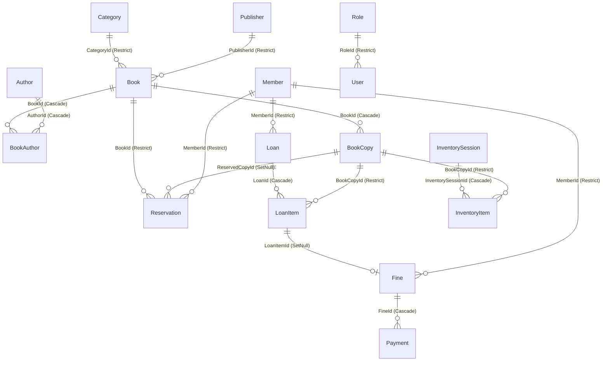

# BÁO CÁO KIỂM TOÁN TOÀN DIỆN HỆ THỐNG (SYSTEM AUDIT REPORT)

- **Dự án:** Hệ thống Quản lý Thư viện Trường học (Desktop .NET 8)
- **Solution:** `Library.sln`
- **Ngày kiểm toán:** 22/10/2026
- **Vai trò thực hiện:** Senior Software Engineer, Software Architect & QA/QC Engineer
- **Phương pháp:** Phân tích tĩnh toàn bộ 100% mã nguồn (Domain, Application, Infrastructure, Desktop, Tests, Configurations), kiểm tra lược đồ cơ sở dữ liệu `library.db` (chế độ chỉ đọc) và thực thi `dotnet build` + `dotnet test`.

---

## PHẦN 1: TỔNG QUAN HỆ THỐNG

### 1.1. Công nghệ và Kiến trúc
- **Nền tảng & Ngôn ngữ:** .NET 8 (`net8.0` cho Core/Infrastructure/Tests, `net8.0-windows` cho WPF Desktop), C# 12 (`Nullable=enable`, `ImplicitUsings=enable`, `TreatWarningsAsErrors=true`).
- **Kiến trúc:** Clean Architecture kết hợp CQRS và MVVM:
  - `Library.Domain`: Chứa Entities, Enums, hằng số nghiệp vụ (`BusinessRuleConstants`), mẫu `Result<T>` / `Error` / `DomainErrors`, và Domain Services (`CirculationPolicyService`, `FineCalculator`).
  - `Library.Application`: Tổ chức theo Feature (`Auth`, `Catalog`, `Circulation`, `Fines`, `Inventory`, `Members`, `Reports`, `System`), sử dụng **MediatR (v12.4.1)** cho Command/Query và **FluentValidation (v11.10.0)**.
  - `Library.Infrastructure`: Sử dụng **EF Core SQLite (v8.0.10)**, Repository Pattern + `UnitOfWork`, **ClosedXML (v0.104.2)** để nhập/xuất Excel, **QuestPDF (v2024.10.1)** để kết xuất PDF, bộ sinh mã vạch Code128 BMP (`BarcodeGenerator`), và băm mật khẩu PBKDF2-SHA256 (`PasswordHasher`).
  - `Library.Desktop`: Ứng dụng Desktop **WPF** sử dụng **CommunityToolkit.Mvvm (v8.3.2)** và `Microsoft.Extensions.Hosting`.
- **Cơ sở dữ liệu:** SQLite (`library.db`), khởi tạo qua `Database.EnsureCreatedAsync()` trong `DatabaseInitializer` (chưa sử dụng thư mục EF Migrations).

### 1.2. Cấu trúc thư mục
```text
QUAN_LY_THU_VIEN/
├── .editorconfig
├── .gitignore
├── Directory.Build.props
├── Library.sln
├── Chay_Ung_Dung.bat
├── library.db                              # File CSDL SQLite hiện tại
├── app_log.txt                             # File log khởi động của WPF
├── README.md                               # [File lạ] Tài liệu test case C# -> UML không thuộc dự án
├── 01_SimpleClass.cs .. 05_NestedClass.cs  # [File lạ] 5 file C# mẫu của công cụ dịch ngược UML
├── library-desktop-standards/              # Bộ quy chuẩn kiến trúc, code style và workflow của dự án
├── src/
│   ├── Library.Domain/                     # Entities, Enums, Common, Services
│   ├── Library.Application/                # Common/Interfaces, Common/Models, Features/*
│   ├── Library.Infrastructure/             # Persistence (DbContext, Configurations, Repositories), Services
│   └── Library.Desktop/                    # Views (XAML), ViewModels, Services, Styles/Theme.xaml
└── tests/
    ├── Library.Domain.Tests/               # 15 unit tests cho Domain rules
    ├── Library.Application.Tests/          # 6 unit tests cho Auth & Circulation handlers
    └── Library.Infrastructure.Tests/       # 2 integration tests với SQLite in-memory
```

### 1.3. Danh sách Module, Màn hình (Views) và Chức năng
Hệ thống không sử dụng REST API (vì là ứng dụng Desktop độc lập chạy offline), mà giao tiếp giữa Frontend (WPF ViewModels) và Backend (Application Handlers) thông qua **MediatR Requests (Commands & Queries)**:

| Phân hệ (Module) | Màn hình (View / ViewModel) | Các Request (Command / Query) ở tầng Application |
|---|---|---|
| **1. Xác thực & Tài khoản (`Auth`)** | `LoginView` (`LoginViewModel`)<br>`SystemView` - Tab 2 (`SystemViewModel`) | `LoginCommand`, `CreateUserCommand`, `ResetPasswordCommand`, `GetUsersQuery` |
| **2. Tổng quan (`Dashboard`)** | `DashboardView` (`DashboardViewModel`) | `GetDashboardStatisticsQuery`, `GetOverdueReportQuery` |
| **3. Mượn / Trả & Đặt trước (`Circulation`)** | `CirculationView` (`CirculationViewModel`) | `BorrowBookCommand`, `ReturnBookCommand`, `RenewLoanCommand`, `CreateReservationCommand`, `GetOverdueLoansQuery`, `GetActiveLoansByMemberQuery` |
| **4. Danh mục sách (`Catalog`)** | `CatalogView` (`CatalogViewModel`) | `CreateBookCommand`, `UpdateBookCommand`, `DeleteBookCommand`, `AddBookCopiesCommand`, `ImportBooksExcelCommand`, `GetBooksQuery`, `GetBookByIdQuery`, `GetCatalogLookupsQuery` |
| **5. Bạn đọc (`Members`)** | `MemberView` (`MemberViewModel`) | `CreateMemberCommand`, `UpdateMemberCommand`, `ReissueCardCommand`, `BatchGraduateMembersCommand`, `ImportMembersExcelCommand`, `GetMembersQuery`, `GetMemberByIdQuery`, `GetMemberByCardNumberQuery`, `GetMemberDetailHistoryQuery` |
| **6. Tiền phạt (`Fines`)** | `FineView` (`FineViewModel`) | `PayFineCommand`, `WaiveFineCommand`, `GetFinesQuery` |
| **7. Kiểm kê kho (`Inventory`)** | `InventoryView` (`InventoryViewModel`) | `CreateInventorySessionCommand`, `ScanInventoryBarcodeCommand`, `CompleteInventorySessionCommand`, `GetInventorySessionsQuery` |
| **8. Báo cáo (`Reports`)** | `ReportView` (`ReportViewModel`) | `GetDashboardStatisticsQuery`, `GetOverdueReportQuery` *(thiếu handler cho `TopBookDto`, `TopReaderDto`)* |
| **9. Hệ thống (`System`)** | `SystemView` (`SystemViewModel`) | `UpdateSettingCommand`, `CreateBackupCommand`, `RestoreBackupCommand`, `GetSettingsQuery`, `GetAuditLogsQuery` |

### 1.4. Danh sách Bảng Cơ sở dữ liệu (18 bảng)
Đã xác minh trực tiếp trong `LibraryDbContext` và file `library.db`:
1. `Books` (Đầu sách)
2. `BookCopies` (Bản sao sách)
3. `Authors` (Tác giả)
4. `Categories` (Thể loại)
5. `Publishers` (Nhà xuất bản)
6. `BookAuthors` (Bảng trung gian N-N giữa `Books` và `Authors`)
7. `Members` (Bạn đọc: Học sinh / Giáo viên)
8. `Loans` (Phiếu mượn)
9. `LoanItems` (Chi tiết từng cuốn sách mượn)
10. `Reservations` (Phiếu đặt trước sách)
11. `Fines` (Phiếu phạt)
12. `Payments` (Lịch sử thanh toán tiền phạt)
13. `InventorySessions` (Đợt kiểm kê kho)
14. `InventoryItems` (Chi tiết bản sao được kiểm kê)
15. `Users` (Tài khoản cán bộ thư viện)
16. `Roles` (Vai trò: `Admin`, `Librarian`, `Assistant`)
17. `AuditLogs` (Nhật ký kiểm toán)
18. `Settings` (Tham số cấu hình hệ thống)

### 1.5. Kết quả kiểm tra thực tế & Những thành phần chưa thể xác minh
- **Đã kiểm tra thực tế:**
  - Đọc và phân tích 100% file mã nguồn, XAML, cấu hình, test và tài liệu chuẩn (`library-desktop-standards`).
  - Chạy `dotnet build Library.sln --no-incremental`: **Build thành công (0 Warning, 0 Error)**.
  - Chạy `dotnet test Library.sln --no-build`: **23/23 test đều Pass** (`Library.Domain.Tests`: 15, `Library.Application.Tests`: 6, `Library.Infrastructure.Tests`: 2).
  - Truy vấn kiểm tra lược đồ DDL, khóa chính, khóa ngoại, index và số dòng dữ liệu thực tế trên `library.db` ở chế độ chỉ đọc (`mode=ro`).
- **Chưa thể xác minh trực tiếp:**
  - Tương tác chuột/bàn phím trực tiếp và độ mượt hiệu ứng render WPF trên màn hình vật lý ở các độ phân giải DPI khác nhau (do kiểm toán trong môi trường CLI; toàn bộ lỗi UI/UX và binding dưới đây được chứng minh trực tiếp từ mã XAML và ViewModel).

---

## PHẦN 2: DANH SÁCH LỖI CHI TIẾT

| ID | Phân hệ | Vị trí lỗi | Mô tả lỗi | Bằng chứng | Mức độ | Ảnh hưởng | Hướng khắc phục |
|---|---|---|---|---|---|---|---|
| **BUG-001** | Auth / Security / Desktop | `src/Library.Desktop/ViewModels/MainViewModel.cs` (L73-L78)<br>`src/Library.Infrastructure/Services/SecurityServices.cs` (L35-L40) | **Bỏ qua đăng nhập khi khởi động (Authentication Bypass) và gán cứng quyền `Admin` mặc định.** Khi mở ứng dụng, hệ thống không yêu cầu đăng nhập mà vào thẳng `DashboardView` với quyền `Admin`. | Trong `SecurityServices.cs` L37-L40: `CurrentUserService` khởi tạo sẵn `UserId = "Admin"`, `Username = "admin"`, `Role = "Admin"`.<br>Trong `MainViewModel.cs` L77-L78: `CurrentView = DashboardVM; _ = DashboardVM.LoadDataAsync();` thay vì mở `LoginViewModel`. | **Critical** | Bất kỳ ai mở máy tính đều có toàn quyền `Admin` (xóa dữ liệu, miễn phạt, tạo tài khoản, cấu hình hệ thống) mà không cần đăng nhập. Vi phạm nghiêm trọng `AUTH-01`, `AUTH-04`. | 1. Khởi tạo `CurrentUserService` với `UserId = null`, `Username = null`, `Role = null`.<br>2. Trong constructor `MainViewModel`, đặt `CurrentView = _serviceProvider.GetRequiredService<LoginViewModel>()` khi `!_currentUser.IsAuthenticated`. |
| **BUG-002** | Auth / Security | `src/Library.Application/Features/Auth/Commands/AuthCommands.cs` (L41-L71) | **Tài khoản bị khóa vĩnh viễn / vô hiệu hóa (`IsActive = false`) vẫn đăng nhập thành công.** `LoginCommandHandler` không kiểm tra thuộc tính `user.IsActive`. | Tại `AuthCommands.cs` L46-L50: chỉ kiểm tra `if (user is null)` và `if (user.IsLockedOut(now))`, hoàn toàn không có nhánh kiểm tra `if (!user.IsActive)`. | **Critical** | Cán bộ đã nghỉ việc hoặc bị thu hồi quyền (`IsActive = false`) vẫn đăng nhập và thao tác được trên hệ thống. | Thêm kiểm tra `if (!user.IsActive) return Result.Failure<LoginResultDto>(DomainErrors.Auth.AccountLocked);` (hoặc mã lỗi `AUTH.ACCOUNT_DISABLED`) ngay sau `if (user is null)`. |
| **BUG-003** | Architecture / Database / Desktop | `src/Library.Desktop/App.xaml.cs` (L77-L90)<br>`src/Library.Desktop/ViewModels/MainViewModel.cs` (L45-L79, L100-L147)<br>`src/Library.Infrastructure/DependencyInjection.cs` (L14-L32) | **Captive Dependency: `LibraryDbContext` (Scoped) bị giữ sống như Singleton trong suốt vòng đời ứng dụng.** `MainViewModel` là Singleton và giữ tham chiếu trực tiếp tới tất cả 8 ViewModel con được resolve từ root container, khiến toàn bộ ứng dụng dùng chung 1 instance `LibraryDbContext` duy nhất. | 1. `App.xaml.cs` L78: `services.AddSingleton<MainViewModel>()`.<br>2. `MainViewModel.cs` L45-L70: inject trực tiếp 8 ViewModel vào constructor.<br>3. `MainViewModel.cs` L78, L109-L140: gọi `_ = ...LoadAsync()` kiểu fire-and-forget. | **Critical** | 1. Khi người dùng chuyển tab nhanh, 2 tác vụ async truy cập cùng 1 `LibraryDbContext` gây văng lỗi `InvalidOperationException: A second operation was started on this context instance...`<br>2. `ChangeTracker` tích tụ thực thể suốt phiên làm việc, gây rò rỉ bộ nhớ và dữ liệu cũ (stale state). | Đăng ký `IDbContextFactory<LibraryDbContext>` hoặc tạo `IServiceScope` cho mỗi lần gửi request qua `IMediator` (hoặc resolve ViewModel mới theo scope mỗi khi điều hướng). Không gọi fire-and-forget `_ = ...` không kiểm soát. |
| **BUG-004** | Catalog / Backend | `src/Library.Application/Features/Catalog/Commands/CatalogCommands.cs` (L87-L90, L112, L172-L176, L181)<br>`src/Library.Application/Features/Catalog/DTOs/CatalogDtos.cs` (L62) | **Văng ngoại lệ `NullReferenceException` mỗi khi thêm mới hoặc cập nhật đầu sách có tác giả.** | 1. `LookupRepository.GetAuthorsAsync` dùng `.AsNoTracking()` (`SystemRepositories.cs` L183).<br>2. `CreateBookCommandHandler` (L89) và `UpdateBookCommandHandler` (L175) tạo `new BookAuthor { BookId = book.Id, AuthorId = authorId }` mà `ba.Author` là `null`.<br>3. L112 & L181 gọi `BookDto.From(book)` -> `CatalogDtos.cs` L62: `book.BookAuthors.Select(ba => ba.Author.FullName)` truy cập `ba.Author` (`null`) gây crash! | **Critical** | Người dùng bấm "Lưu đầu sách" trên giao diện `CatalogView` luôn nhận thông báo lỗi `"Lỗi lưu đầu sách: Object reference not set to an instance of an object"`, dù sách đã lọt vào DB. | Trong `BookDto.From(book)` (`CatalogDtos.cs` L62), kiểm tra null `ba.Author != null ? ba.Author.FullName : ...`, đồng thời trong `CreateBookCommandHandler` / `UpdateBookCommandHandler`, truy vấn lại `await _books.GetByIdAsync(book.Id, ct)` hoặc nạp `Author`/`Category`/`Publisher` trước khi map sang `BookDto`. |
| **BUG-005** | Circulation / Business Logic | `src/Library.Application/Features/Circulation/Commands/BorrowBookCommand.cs` (L62-L85)<br>`src/Library.Domain/Services/CirculationPolicyService.cs` (L30-L31) | **Bạn đọc đã đặt trước sách (`ReservationStatus.Notified`) không thể mượn cuốn sách đang giữ chỗ cho chính mình.** Luôn bị từ chối với lỗi `CIR.COPY_UNAVAILABLE`. | Tại `BorrowBookCommand.cs` L63-L75: khi `copy.Status == CopyStatus.Reserved`, handler gọi `activeRes.Fulfill(now)` nhưng **không** đổi `copy.Status` sang `CopyStatus.Available` trước khi gọi `CirculationPolicyService.CanBorrow(...)` ở L81. Trong `CanBorrow` (L30), `if (!copy.CanBeBorrowed)` trả về `Failure(CopyUnavailable)` vì `copy.Status` vẫn là `Reserved`! | **High** | Luồng đặt trước sách (`CIR-06`, `BR-10`) bị đứt gãy hoàn toàn: ngay khi sách trả về và chuyển sang giữ chỗ (`Reserved`), không ai (kể cả người đặt trước) có thể mượn cuốn sách đó nữa. | 1. Trong `BorrowBookCommandHandler` L73: sau khi xác nhận `activeRes` hợp lệ (và chưa hết hạn `HoldExpiresAtUtc`), gọi `copy.MarkAvailable()` trước khi gọi `CirculationPolicyService.CanBorrow`.<br>2. Kiểm tra thêm `r.ReservedCopyId == copy.Id` và `!r.IsExpired(now)`. |
| **BUG-006** | Fines / Domain Logic | `src/Library.Domain/Entities/Fine.cs` (L22-L23, L48-L53)<br>`src/Library.Domain/Entities/Member.cs` (L50-L55) | **Lỗi tính đúp tiền thanh toán trong `Fine.AddPayment` và tính sai nợ phạt trong `Member.GetUnpaidFineTotal`.** | 1. `Fine.cs` L22: `PaidAmount => Payments.Where(p => !p.IsDeleted).Sum(p => p.Amount);`<br>2. `Fine.cs` L48-L50: gọi `Payments.Add(payment);` rồi kiểm tra `if (PaidAmount + amount >= Amount)`. Vì `PaidAmount` đã tính cả `payment` vừa thêm, `amount` bị cộng 2 lần!<br>3. `Member.cs` L54: `.Sum(f => f.Amount)` thay vì `f.RemainingAmount`. | **High** | Nếu bạn đọc nợ 20.000đ và đóng 10.000đ (50%), `PaidAmount + amount` = `10.000 + 10.000 = 20.000 >= 20.000`, hệ thống đánh dấu `FineStatus.Paid` (đã trả đủ) ngay lập tức, làm thất thoát tiền phạt! | 1. Tại `Fine.cs` L50: sửa điều kiện thành `if (PaidAmount >= Amount) Status = FineStatus.Paid;`.<br>2. Tại `Member.cs` L54: sửa `.Sum(f => f.Amount)` thành `.Sum(f => f.RemainingAmount)`. |
| **BUG-007** | Inventory / Business Logic | `src/Library.Application/Features/Inventory/Commands/InventoryCommands.cs` (L29-L47, L72-L114, L133-L148)<br>`src/Library.Desktop/ViewModels/InventoryViewModel.cs` (L23) | **Chức năng Kiểm kê kho (`INV-01` → `INV-03`) tính sai hoàn toàn số sách dự kiến (`TotalExpected`), sách mất (`TotalMissing`) và sách hỏng (`TotalDamaged`).** | 1. `CreateInventorySessionCommandHandler` (L33-L45) không nạp danh sách `BookCopy` hiện có của kệ vào `session.Items` và để `TotalExpected = 0`.<br>2. `ScanInventoryBarcodeCommandHandler` chỉ thêm các cuốn được quét với `ResultStatus = Normal`.<br>3. `CompleteInventorySessionCommandHandler` (L141-L142) đếm `session.Items.Count(i => i.ResultStatus == Missing)` -> luôn bằng `0` vì sách bị mất không được quét nên không có trong `session.Items`! | **High** | Báo cáo kiểm kê kho hoàn toàn vô tác dụng: dù mất toàn bộ sách trong kho thì khi chốt kiểm kê, `TotalMissing` và `TotalDamaged` vẫn luôn bằng `0`. | 1. Khi tạo `InventorySession`, truy vấn tất cả `BookCopy` thuộc `ShelfLocation` (hoặc toàn bộ kho nếu chọn tất cả kệ), gán `TotalExpected = copies.Count`, và tạo sẵn `InventoryItem` với `ResultStatus = InventoryResultStatus.Missing`.<br>2. Khi quét mã vạch, cập nhật `ResultStatus` từ `Missing` sang `Normal`/`Found`/`Damaged`. |
| **BUG-008** | System / Business Logic | `src/Library.Application/Features/Circulation/Commands/BorrowBookCommand.cs` (L81-L87)<br>`ReturnBookCommand.cs` (L78-L90)<br>`RenewLoanCommand.cs` (L53, L57)<br>`ReportQueries.cs` (L93)<br>`MainViewModel.cs` (L17) | **Toàn bộ thông số cấu hình trong bảng `Settings` (`SYS-01`) bị bỏ qua trong nghiệp vụ.** Admin sửa cấu hình trên màn hình `SystemView` và lưu vào DB thành công, nhưng hệ thống vẫn dùng hằng số cứng trong `BusinessRuleConstants`. | Không một Handler nào trong `Circulation`, `Fines`, `Reports` hay `MainViewModel` inject `ISettingRepository`. Ví dụ: `BorrowBookCommandHandler` (L81, L87) gọi `member.GetLoanDurationDays()` và `CanBorrow(...)` với tham số mặc định từ `BusinessRuleConstants`; `MainViewModel` (L17) gán cứng `_schoolName = "THƯ VIỆN TRƯỜNG HỌC"`. | **High** | Chức năng Cấu hình hệ thống (`SYS-01`) chỉ lưu vào DB chứ không có bất kỳ tác động nào đến hạn mức mượn, số ngày mượn, mức phạt/ngày, ngưỡng nợ phạt hay tên trường trên Header. | Inject `ISettingRepository` vào `BorrowBookCommandHandler`, `ReturnBookCommandHandler`, `RenewLoanCommandHandler`, `GetOverdueReportQueryHandler`, và `MainViewModel` để đọc các khóa cấu hình (`StudentBorrowLimit`, `DailyLateFineRate`, `SchoolName`...) với fallback về `BusinessRuleConstants`. |
| **BUG-009** | Application / Validation | `src/Library.Application/DependencyInjection.cs` (L9-L21) | **FluentValidation không bao giờ được thực thi do thiếu MediatR `IPipelineBehavior`.** | `DependencyInjection.cs` L13-L18 gọi `services.AddValidatorsFromAssembly(assembly)` nhưng không đăng ký `IPipelineBehavior<,>` trong `AddMediatR`, và các CommandHandler cũng không gọi `IValidator<T>.ValidateAsync()`. | **High** | Mọi `AbstractValidator<T>` trong tầng Application đều là code chết (dead code). Nếu gửi Command qua MediatR với dữ liệu rỗng/âm (ví dụ `Price < 0`, `Amount <= 0`), Validator không chặn lại. | Tạo `ValidationBehavior<TRequest, TResponse> : IPipelineBehavior<TRequest, TResponse>` trả về `Result.Failure` khi có lỗi validation, và đăng ký vào `AddMediatR`. Bổ sung Validator cho các Command còn thiếu. |
| **BUG-010** | Security / Authorization & Audit | `src/Library.Application/Features/Auth/Commands/AuthCommands.cs`<br>`CatalogCommands.cs`<br>`FineCommands.cs`<br>`SystemCommands.cs`<br>`MemberCommands.cs` | **Thiếu kiểm tra phân quyền (RBAC) ở tầng Application và thiếu ghi `AuditLog` cho nhiều thao tác nhạy cảm.** | 1. Chỉ có `WaiveFineCommandHandler` và `GetAuditLogsQueryHandler` kiểm tra `_currentUser.Role`.<br>2. `CreateUserCommand`, `ResetPasswordCommand`, `UpdateSettingCommand`, `CreateBackupCommand`, `RestoreBackupCommand` không kiểm tra quyền `Admin`.<br>3. `CreateBook`, `UpdateBook`, `DeleteBook`, `PayFine` không chặn vai trò `Assistant`.<br>4. `DeleteBook`, `CreateUser`, `ResetPassword` không ghi `AuditLog`, và gán cứng `CreatedBy = "System"`/`"Admin"`. | **High** | Vi phạm quy tắc bảo mật cốt lõi (`SEC-05`, `SEC-07`): phân quyền chỉ dựa vào việc ẩn/khóa nút trên UI (`MainWindow.xaml` L121, L124, L128) mà không bảo vệ ở tầng Application; mất dấu vết kiểm toán khi xóa sách hoặc đặt lại mật khẩu. | 1. Bổ sung kiểm tra `ICurrentUserService.Role` trong các Handler (hoặc qua `AuthorizationBehavior`).<br>2. Ghi `AuditLog` trong `CreateUserCommandHandler`, `ResetPasswordCommandHandler`, `DeleteBookCommandHandler`, `BatchGraduateMembersCommandHandler`.<br>3. Lấy `_currentUser.Username` cho `CreatedBy`/`UpdatedBy`. |
| **BUG-011** | Circulation / Data Integrity | `src/Library.Application/Features/Circulation/Commands/ReturnBookCommand.cs` (L52-L156)<br>`src/Library.Infrastructure/Persistence/LibraryDbContext.cs` (L57-L61) | **1. `Loan.Status` không bao giờ chuyển sang `LoanStatus.Returned` khi trả hết sách.<br>2. Lỗi xung đột đồng thời (`DbUpdateConcurrencyException`) không được chuyển thành `Result.Failure(ConcurrencyConflict)`.** | 1. `ReturnBookCommandHandler` chỉ cập nhật `loanItem` và `copy`, không kiểm tra nếu toàn bộ `loanItem.Loan.Items` đã trả thì cập nhật `loanItem.Loan.Status = LoanStatus.Returned`.<br>2. `LibraryDbContext.cs` L60 ném `InvalidOperationException` khi có `DbUpdateConcurrencyException`, còn các Handler không bắt lỗi này để trả về `DomainErrors.Circulation.ConcurrencyConflict`. | **High** | 1. Mọi phiếu mượn `Loan` trong CSDL đều mang trạng thái `Active` (1) vĩnh viễn dù sách đã trả hết.<br>2. Khi xảy ra xung đột đồng thời, ứng dụng ném Exception thô thay vì trả về `Result.Failure` theo chuẩn. | 1. Trong `ReturnBookCommandHandler`, nạp đầy đủ `Loan.Items`; nếu tất cả `Items` đều `IsReturned`, gán `loan.Status = LoanStatus.Returned` và gọi `_loans.Update(loan)`.<br>2. Bắt `DbUpdateConcurrencyException` / `InvalidOperationException` ở biên hoặc `UnitOfWork` để trả về `DomainErrors.Circulation.ConcurrencyConflict`. |
| **BUG-012** | Catalog & Members / Data Integrity | `src/Library.Application/Features/Catalog/Commands/CatalogCommands.cs` (L95, L260)<br>`ImportBooksExcelCommand.cs` (L123)<br>`src/Library.Desktop/ViewModels/MemberViewModel.cs` (L110) | **Sinh mã vạch (`Barcode`) và mã thẻ (`CardNumber`) bằng `DateTime.UtcNow.Ticks % 10000000` dễ bị trùng lặp (`UNIQUE constraint failed`).** | `var barcode = $"CP-{DateTime.UtcNow.Ticks % 10000000:D7}-{i:D2}";`<br>`10,000,000` ticks chỉ bằng đúng 1 giây (và lặp lại mỗi giây). Trong `ImportBooksExcelCommand.cs` L123, vòng lặp xử lý nhiều dòng Excel trong cùng 1 mili-giây sẽ sinh ra cùng một `Barcode` cho 2 đầu sách khác nhau. | **Medium** | Khi nhập sách từ file Excel có nhiều dòng hoặc thêm bản sao liên tiếp, các dòng có cùng `Ticks` sẽ bị lỗi `UNIQUE constraint failed: BookCopies.Barcode` và không thể import. | Sử dụng số thứ tự tăng dần kết hợp chuỗi ngẫu nhiên an toàn / phần đầu của `Guid.NewGuid()` hoặc kiểm tra `ExistsBarcodeAsync` trước khi gán; dùng `_time.GetUtcNow()` thay vì `DateTime.UtcNow`. |
| **BUG-013** | Database / EF Core Schema | `src/Library.Infrastructure/Persistence/Configurations/CatalogConfigurations.cs` (L16, L41)<br>`CirculationConfigurations.cs` (L14, L40-L63)<br>`SystemConfigurations.cs` (L48, L69, L96) | **1. Các Unique Index không loại trừ bản ghi đã xóa mềm (`WHERE IsDeleted = 0`).<br>2. Bảng `LoanItems` thiếu Unique Filtered Index chống mượn trùng 1 bản sao.** | 1. `IX_BookCopies_Barcode`, `IX_Books_Isbn`, `IX_Members_CardNumber`, `IX_Users_Username` là Unique Index trên toàn bảng (kể cả `IsDeleted = 1`), trong khi `Exists*Async` dùng Global Query Filter (`IsDeleted = 0`).<br>2. `LoanItemConfiguration` không có unique index cho `(BookCopyId) WHERE ReturnedAtUtc IS NULL`. | **Medium** | 1. Sau khi xóa mềm một đầu sách/bản sao, nếu thêm lại sách có cùng ISBN/Barcode, hàm `ExistsIsbnAsync` báo chưa tồn tại nhưng lệnh `SaveChangesAsync` văng lỗi `SqliteException: UNIQUE constraint failed`.<br>2. Thiếu chốt chặn ở tầng CSDL cho quy tắc "1 bản sao chỉ có tối đa 1 lượt mượn chưa trả". | 1. Thêm `.HasFilter("[IsDeleted] = 0")` (và `[Isbn] IS NOT NULL AND [IsDeleted] = 0` cho ISBN) vào các Unique Index.<br>2. Thêm `builder.HasIndex(x => x.BookCopyId).IsUnique().HasFilter("[ReturnedAtUtc] IS NULL AND [IsDeleted] = 0");` vào `LoanItemConfiguration`. |
| **BUG-014** | Database / Performance & Search | `src/Library.Infrastructure/Persistence/Repositories/CatalogRepositories.cs` (L51-L56)<br>`CirculationRepositories.cs` (L40-L45)<br>`src/Library.Application/Features/Members/Queries/MemberQueries.cs` (L36-L41)<br>`ReportQueries.cs` (L39-L58) | **1. Tìm kiếm tiếng Việt có dấu chữ hoa (`Đ, Ê, Ư, Á...`) không khớp do `lower()` của SQLite chỉ hỗ trợ ASCII.<br>2. Lỗi truy vấn N+1 ở `GetMembersQueryHandler` và nạp 10.000 dòng vào RAM ở `GetDashboardStatisticsQueryHandler`.<br>3. Tính thiếu doanh thu phạt tháng cho các phiếu nộp 1 phần.** | 1. `b.Title.ToLower().Contains(term)` dịch sang SQL `lower(b.Title)` không hạ chữ thường cho ký tự Unicode tiếng Việt trong SQLite, trong khi `term` đã hạ chữ thường trong C#.<br>2. `MemberQueries.cs` L36-L41 lặp qua từng `Member` để gọi 2 query `GetActiveLoanItemsByMemberIdAsync` và `GetUnpaidByMemberIdAsync`.<br>3. `ReportQueries.cs` L39-L58 gọi `GetPagedAsync(1, 10000)` cho 4 bảng và lọc `FineStatus.Paid` (bỏ sót `Payment` của phiếu `Pending`). | **Medium** | 1. Tìm kiếm `"đắc nhân tâm"` hoặc `"trần thị mai"` bằng chữ thường không tìm ra bản ghi có chữ hoa tiếng Việt ở đầu từ.<br>2. Hiệu năng suy giảm mạnh khi dữ liệu tăng.<br>3. Dashboard hiển thị sai doanh thu tiền phạt trong tháng nếu có phiếu phạt thu một phần. | 1. Dùng `EF.Functions.Like` kết hợp đăng ký custom collation/function ` NOCASE` hỗ trợ Unicode trên `SqliteConnection`.<br>2. Gộp truy vấn đếm số sách đang mượn và tổng nợ phạt bằng projection `Select` trong `MemberRepository`.<br>3. Viết phương thức thống kê trực tiếp bằng SQL `CountAsync`/`SumAsync` tại Repository cho Dashboard. |
| **BUG-015** | Frontend / Integration | `src/Library.Desktop/Views/*.xaml`<br>`src/Library.Desktop/ViewModels/*.cs`<br>`src/Library.Application/Features/Members/Queries/MemberQueries.cs` (L149) | **Nhiều chức năng đã có ở tầng Application/Infrastructure nhưng chưa được kết nối lên UI hoặc bị gán cứng (hardcode) tham số.** | 1. **Catalog:** Chưa nối UI cho Sửa sách (`UpdateBook`), Xóa sách (`DeleteBook`), Nhập Excel (`ImportBooksExcel`), In mã vạch (`IBarcodeGenerator`). Form thêm sách thiếu chọn Tác giả, Giá bìa, Số trang, `IsReferenceOnly`; nút `+ Thêm bản` gán cứng `Quantity = 2`, `"Kệ A1"`.<br>2. **Members:** Chưa nối UI cho Sửa/Khóa bạn đọc (`UpdateMember`), Cấp lại thẻ (`ReissueCard`), Chuyển lớp cuối năm (`BatchGraduateMembers`), Nhập Excel (`ImportMembersExcel`), Lịch sử bạn đọc (`GetMemberDetailHistory` - bản thân handler L149 cũng đang truyền nhầm `activeLoans` vào `BorrowHistory`). Form thêm bạn đọc thiếu chọn Ngày sinh.<br>3. **Circulation:** Chưa nối UI cho Đặt trước (`CreateReservation`); tab Quá hạn thiếu cột Tên bạn đọc/Mã thẻ và hiện nút "Gia hạn" không hợp lệ.<br>4. **Fines:** Chưa nối `IPdfService.GenerateReceiptPdf` khi thu phạt; miễn phạt gán cứng lý do.<br>5. **Reports:** Chưa có handler và UI cho Top sách / Top bạn đọc (`TopBookDto`, `TopReaderDto`) và lọc theo ngày.<br>6. **System:** Chưa nối `ResetPasswordCommand` và `RestoreBackupCommand`; cột `LastLoginAtUtc` (`SystemView.xaml` L92) binding vào thuộc tính không tồn tại trên `UserDto`; chưa có tự động đăng xuất sau 15 phút (`AUTH-06`). | **Medium** | Người dùng cuối không thể thực hiện trọn vẹn các chức năng quản trị vòng đời sách, bạn đọc, đặt trước, in biên lai PDF, nhập Excel và khôi phục sao lưu từ giao diện phần mềm. | Kết nối đầy đủ các Command/Query/Service sẵn có vào các ViewModel và View tương ứng; bổ sung các trường nhập liệu còn thiếu trên Form/Dialog; thêm `LastLoginAtUtc` vào `User` & `UserDto`; triển khai `DispatcherTimer` 15 phút cho `AUTH-06`. |
| **BUG-016** | Security / UI/UX | `src/Library.Desktop/Views/LoginView.xaml` (L51-L54, L74-L76)<br>`src/Library.Desktop/ViewModels/LoginViewModel.cs` (L18-L19)<br>`src/Library.Desktop/Views/SystemView.xaml` (L66) | **Lộ mật khẩu dạng plain-text trên giao diện Đăng nhập và Tạo tài khoản; điền sẵn mật khẩu Admin mặc định.** | 1. `LoginView.xaml` L51 và `SystemView.xaml` L66 dùng `<TextBox Text="{Binding Password...}"/>` thay vì `<PasswordBox/>` (dù `Theme.xaml` L87 đã có `ModernPasswordBox`).<br>2. `LoginViewModel.cs` L18-L19 gán sẵn `_username = "admin"` và mật khẩu mặc định.<br>3. `LoginView.xaml` L74 hiển thị công khai tài khoản và mật khẩu mặc định ngay dưới nút Đăng nhập. | **Medium** | Mật khẩu hiển thị rõ từng ký tự khi gõ trên màn hình (nguy cơ lộ mật khẩu qua vai hoặc khi chia sẻ màn hình) và bất kỳ học sinh nào nhìn màn hình đăng nhập cũng biết mật khẩu `admin`. | 1. Thay `TextBox` nhập mật khẩu bằng `PasswordBox` với `Style="{StaticResource ModernPasswordBox}"`.<br>2. Xóa giá trị mật khẩu mặc định trong `LoginViewModel` và xóa dòng chữ gợi ý mật khẩu trên `LoginView.xaml`. |
| **BUG-017** | Architecture / Hygiene | Thư mục gốc (`01_SimpleClass.cs` → `05_NestedClass.cs`, `README.md`, `app_log.txt`)<br>`src/Library.Desktop/App.xaml.cs` (L54-L62, L118, L151) | **1. Thư mục gốc chứa 5 file `.cs` và `README.md` của một dự án khác (công cụ dịch ngược C# → UML).<br>2. `App.xaml.cs` ghi log bằng `File.AppendAllText` và chặn UI thread bằng `.GetAwaiter().GetResult()`.** | 1. `01_SimpleClass.cs` .. `05_NestedClass.cs` và `README.md` thuộc đề tài *"T4.1 — Bộ Mã Nguồn C# Mẫu Chuẩn Test Case"*.<br>2. `App.xaml.cs` L118: `dbInitializer.InitializeAsync().GetAwaiter().GetResult();` và L151: `_host.StopAsync().GetAwaiter().GetResult();` vi phạm quy tắc cấm đồng bộ hóa tác vụ async trên UI thread (`SKILL.md` L46). | **Low** | Gây nhầm lẫn khi bảo trì/bàn giao kho mã nguồn; thiếu cơ chế xoay vòng log Serilog theo chuẩn (`NFR-08`); nguy cơ deadlock trên UI thread khi khởi động/tắt ứng dụng. | 1. Dọn dẹp hoặc di chuyển 5 file test UML ra khỏi root và cập nhật `README.md` đúng với dự án Quản lý thư viện.<br>2. Chuyển `OnStartup` và `OnExit` sang `async void` với `await`, cấu hình `UseSerilog()` thay cho `File.AppendAllText`. |

---

## PHẦN 3: ĐÁNH GIÁ CHỨC NĂNG

| Chức năng | Vị trí triển khai | Trạng thái | Lỗi liên quan | Kiểm thử cần thực hiện |
|---|---|---|---|---|
| **AUTH-01 / AUTH-02: Đăng nhập & Băm mật khẩu PBKDF2** | `AuthCommands.cs`, `SecurityServices.cs`, `LoginViewModel.cs`, `MainViewModel.cs` | **Có lỗi** | `BUG-001`, `BUG-002`, `BUG-016` | Kiểm thử khởi động app bắt buộc hiện màn hình Login; đăng nhập đúng/sai mật khẩu; đăng nhập với tài khoản `IsActive = false`. |
| **AUTH-03: Khóa tạm thời 5 phút khi sai mật khẩu 5 lần** | `User.cs` (L30-L38), `AuthCommands.cs` (L49-L60) | **Hoạt động tốt** | *(Không có)* | Đã có unit test `Handle_FiveConsecutiveFailedLogins_LocksAccountForFiveMinutes` (Pass). Cần test thêm mở khóa sau 5 phút. |
| **AUTH-04: Phân quyền theo vai trò (`Admin`, `Librarian`, `Assistant`)** | `MainViewModel.cs` (L20-L21), `WaiveFineCommandHandler`, `GetAuditLogsQueryHandler` | **Chưa hoàn thiện** | `BUG-001`, `BUG-010` | Kiểm thử đăng nhập bằng `Assistant` và `Librarian`, xác minh quyền truy cập ở cả UI và Application Handler. |
| **AUTH-05: Quản lý tài khoản & Đặt lại mật khẩu** | `AuthCommands.cs` (L75-L170), `SystemViewModel.cs`, `SystemView.xaml` | **Chưa hoàn thiện** | `BUG-010`, `BUG-015`, `BUG-016` | Tạo tài khoản trùng username; kiểm thử nút Reset Password trên UI; kiểm tra cột `LastLoginAtUtc` và `AuditLog`. |
| **AUTH-06: Tự động đăng xuất sau 15 phút không thao tác** | `BusinessRuleConstants.cs` (L52) | **Chưa kết nối** | `BUG-015` | Kiểm thử bộ đếm thời gian không tương tác chuột/bàn phím tự động gọi `Logout` và quay về `LoginView`. |
| **CAT-01 / CAT-02: Thêm, sửa, xóa đầu sách & Danh mục** | `CatalogCommands.cs`, `CatalogViewModel.cs`, `CatalogView.xaml` | **Có lỗi** | `BUG-004`, `BUG-009`, `BUG-013`, `BUG-015` | Thêm sách có chọn tác giả (hiện đang crash `NullReferenceException` - `BUG-004`); sửa sách; xóa sách còn bản sao đang mượn (`CAT-07`). |
| **CAT-03 / CAT-04: Thêm bản sao sách & Quản lý trạng thái bản sao** | `CatalogCommands.cs` (L224-L280), `BookCopy.cs` | **Chưa hoàn thiện** | `BUG-012`, `BUG-015` | Thêm bản sao với số lượng và vị trí kệ tùy chọn từ UI; kiểm tra sinh mã vạch không trùng. |
| **CAT-05: Sinh và in nhãn mã vạch Code128** | `BarcodeGenerator.cs` | **Chưa kết nối** | `BUG-015` | Gọi `GenerateCode128Barcode` từ màn hình Danh mục sách và xuất file ảnh/PDF nhãn in. |
| **CAT-06: Nhập sách hàng loạt từ Excel** | `ImportBooksExcelCommand.cs`, `ExcelService.cs` | **Chưa kết nối** | `BUG-012`, `BUG-015` | Nhập file Excel có dòng hợp lệ, dòng thiếu tiêu đề, dòng trùng ISBN và dòng có nhiều bản sao. |
| **CAT-08: Tìm kiếm, lọc thể loại và phân trang sách** | `CatalogQueries.cs`, `CatalogRepositories.cs`, `CatalogViewModel.cs` | **Có lỗi** | `BUG-014`, `BUG-015` | Tìm kiếm tiếng Việt có dấu chữ hoa/thường; lọc theo `CategoryId` trên UI; chuyển trang trước/sau. |
| **MEM-01 / MEM-02 / MEM-03: Thêm, sửa, khóa thẻ bạn đọc** | `MemberCommands.cs`, `MemberViewModel.cs`, `MemberView.xaml` | **Chưa hoàn thiện** | `BUG-009`, `BUG-013`, `BUG-015` | Thêm học sinh/giáo viên; cập nhật thông tin; chặn khóa thẻ khi bạn đọc còn sách đang mượn (`DomainErrors.Member.HasActiveLoans`). |
| **MEM-04: Nhập danh sách bạn đọc từ Excel** | `ImportMembersExcelCommand.cs`, `ExcelService.cs` | **Chưa kết nối** | `BUG-015` | Nhập file Excel danh sách học sinh đầu năm; kiểm tra báo lỗi từng dòng trùng mã thẻ. |
| **MEM-05: Cấp lại thẻ bạn đọc khi mất** | `MemberCommands.cs` (L131-L164) | **Chưa kết nối** | `BUG-015` | Cấp lại thẻ mới từ UI, kiểm tra tăng `ReissueCount` và cập nhật `CardNumber`. |
| **MEM-06: Tra cứu bạn đọc & Xem lịch sử mượn trả, phạt** | `MemberQueries.cs`, `MemberViewModel.cs` | **Có lỗi** | `BUG-014`, `BUG-015` | Kiểm tra hiệu năng phân trang (N+1 query) và xem chi tiết lịch sử mượn trả (`BorrowHistory` hiện đang trả nhầm `activeLoans`). |
| **MEM-07: Chuyển lớp / Khóa thẻ học sinh ra trường hàng loạt** | `MemberCommands.cs` (L167-L217) | **Chưa kết nối** | `BUG-015` | Thực hiện chuyển lớp hoặc khóa thẻ cuối năm học từ UI, kiểm tra học sinh còn nợ sách. |
| **CIR-01 / CIR-02: Mượn sách & Kiểm tra điều kiện mượn** | `BorrowBookCommand.cs`, `CirculationPolicyService.cs`, `CirculationViewModel.cs` | **Có lỗi** | `BUG-005`, `BUG-008`, `BUG-011` | Mượn sách bình thường (Pass); chặn quá hạn/quá hạn mức/nợ phạt > 20.000đ/sách đọc tại chỗ (Pass); mượn sách đã đặt trước (`BUG-005` - Fail). |
| **CIR-03 / CIR-04: Trả sách & Tính phạt trễ hạn, hư hỏng, mất** | `ReturnBookCommand.cs`, `FineCalculator.cs`, `CirculationViewModel.cs` | **Có lỗi** | `BUG-008`, `BUG-011` | Trả sách đúng hạn/trễ hạn/hỏng nhẹ/hỏng nặng/mất sách; kiểm tra trần phạt theo giá bìa; kiểm tra cập nhật `Loan.Status = Returned`. |
| **CIR-05: Gia hạn sách đang mượn** | `RenewLoanCommand.cs`, `CirculationViewModel.cs` | **Hoạt động tốt** | `BUG-008`, `BUG-015` | Gia hạn tối đa 2 lần, mỗi lần 7 ngày; chặn gia hạn khi quá hạn hoặc có người đặt trước; ẩn nút Gia hạn ở tab Quá hạn. |
| **CIR-06: Đặt trước sách & Giữ chỗ 3 ngày (`BR-10`)** | `CreateReservationCommand.cs`, `ReturnBookCommand.cs` (L128-L140), `Reservation.cs` | **Chưa kết nối** | `BUG-005`, `BUG-015` | Tạo đặt trước trên UI; trả sách tự động giữ chỗ 3 ngày; tự động hủy giữ chỗ khi quá 3 ngày; người đặt trước đến mượn sách (`BUG-005`). |
| **CIR-07: Danh sách mượn quá hạn** | `CirculationQueries.cs`, `CirculationView.xaml` | **Chưa hoàn thiện** | `BUG-015` | Hiển thị đầy đủ Họ tên bạn đọc, Mã thẻ, Số ngày quá hạn và đánh dấu màu cảnh báo. |
| **FIN-01 / FIN-02 / FIN-05: Tự động tạo phiếu phạt khi trả sách** | `ReturnBookCommand.cs` (L74-L125) | **Hoạt động tốt** | `BUG-008` | Đã có unit test & integration test xác nhận tạo phiếu phạt không trùng lặp (`FIN-05`). |
| **FIN-03: Thu tiền phạt (toàn phần / một phần) & In biên lai PDF** | `FineCommands.cs` (L13-L69), `Fine.cs` (L34-L57), `FineViewModel.cs` | **Có lỗi** | `BUG-006`, `BUG-010`, `BUG-015` | Thanh toán 1 phần tiền phạt (hiện bị lỗi cộng đúp `BUG-006`); thanh toán toàn phần; kết xuất biên lai PDF qua `IPdfService`. |
| **FIN-04: Miễn / Giảm tiền phạt (kèm lý do & Audit Log)** | `FineCommands.cs` (L72-L145), `FineViewModel.cs` | **Chưa hoàn thiện** | `BUG-015` | Kiểm tra chặn quyền `Assistant`; bắt buộc người dùng nhập lý do miễn phạt trên UI thay vì dùng chuỗi cố định. |
| **INV-01 / INV-02 / INV-03: Tạo đợt kiểm kê, quét mã vạch & chốt kiểm kê** | `InventoryCommands.cs`, `InventoryViewModel.cs`, `InventoryView.xaml` | **Có lỗi** | `BUG-007` | Tạo đợt kiểm kê theo kệ; quét một số mã vạch; chốt kiểm kê và kiểm tra số lượng sách thiếu (`TotalMissing`) phải khớp thực tế. |
| **RPT-01 → RPT-06: Thống kê Dashboard, Báo cáo & Xuất PDF/Excel** | `ReportQueries.cs`, `ReportViewModel.cs`, `PdfService.cs`, `ExcelService.cs` | **Chưa hoàn thiện** | `BUG-014`, `BUG-015` | Kiểm tra số liệu Dashboard (đặc biệt doanh thu phạt một phần); bổ sung báo cáo Top sách/Top bạn đọc; xuất PDF và Excel. |
| **SYS-01: Quản lý cấu hình tham số nghiệp vụ** | `SystemCommands.cs`, `SystemQueries.cs`, `SystemViewModel.cs` | **Có lỗi** | `BUG-008`, `BUG-010` | Cập nhật cấu hình trên UI và xác minh các luồng Mượn/Trả/Phạt áp dụng ngay giá trị mới. |
| **SYS-02: Sao lưu (giữ 14 bản) & Phục hồi CSDL SQLite** | `BackupService.cs`, `SystemCommands.cs`, `SystemViewModel.cs` | **Chưa hoàn thiện** | `BUG-003`, `BUG-010`, `BUG-015` | Sao lưu thủ công; kiểm tra tự động xóa bản cũ thứ 15; phục hồi CSDL từ file sao lưu trên UI mà không bị khóa file SQLite. |
| **SYS-03 / SYS-04: Ghi nhận và Tra cứu Nhật ký kiểm toán (Audit Log)** | `SystemQueries.cs`, `SystemRepositories.cs`, `SystemView.xaml` | **Chưa hoàn thiện** | `BUG-010` | Kiểm tra chỉ `Admin` xem được Audit Log; bổ sung bộ lọc theo đối tượng/từ khóa trên UI. |

---

## PHẦN 4: ĐÁNH GIÁ CƠ SỞ DỮ LIỆU (DATABASE AUDIT)

### 4.1. Sơ đồ quan hệ thực thể (ERD)


### 4.2. Các bảng, trường và ràng buộc có vấn đề
1. **Xung đột giữa Soft Delete (`IsDeleted`) và Unique Index (`BUG-013`):**
   - Trong `library.db`, các chỉ mục duy nhất:
     - `IX_BookCopies_Barcode ON BookCopies (Barcode)`
     - `IX_Books_Isbn ON Books (Isbn) WHERE [Isbn] IS NOT NULL`
     - `IX_Members_CardNumber ON Members (CardNumber)`
     - `IX_Users_Username ON Users (Username)`
     - `IX_Roles_Name ON Roles (Name)`
     - `IX_Settings_Key ON Settings (Key)`
   - **Vấn đề:** Không có điều kiện lọc `WHERE [IsDeleted] = 0`. Khi một bản ghi bị đánh dấu `IsDeleted = 1`, EF Core Global Query Filter ẩn bản ghi đó khỏi mọi truy vấn `Exists*Async`, nhưng SQLite vẫn giữ giá trị trong Unique Index và ném lỗi `SQLITE_CONSTRAINT_UNIQUE` nếu tạo mới bản ghi có cùng mã.
2. **Thiếu Unique Filtered Index bảo vệ toàn vẹn mượn sách trên `LoanItems` (`BUG-013`):**
   - Quy chuẩn dự án (`library-desktop-standards/references/standards.md` mục 4) yêu cầu: *"Một `BookCopy` chỉ có tối đa một `LoanItem` chưa trả tại một thời điểm."*
   - Hiện tại bảng `LoanItems` chỉ có index thường `IX_LoanItems_BookCopyId`, chưa có Unique Index với điều kiện `WHERE [ReturnedAtUtc] IS NULL AND [IsDeleted] = 0`.
3. **Không đồng bộ giữa Giao diện, DTO và Bảng `Users` (`BUG-015`):**
   - `SystemView.xaml` (L92) hiển thị cột `LastLoginAtUtc` ("Lần đăng nhập cuối"), nhưng thực thể `User` (`SystemEntities.cs` L12-L53), bảng `Users` trong `library.db` và `UserDto` (`AuthDtos.cs`) đều **thiếu trường `LastLoginAtUtc`**.
4. **Cơ chế khởi tạo CSDL (`EnsureCreatedAsync` vs Migrations):**
   - `DatabaseInitializer.cs` (L22) đang dùng `_context.Database.EnsureCreatedAsync(ct)` và dự án chưa có thư mục `Migrations/`. Khi thay đổi schema (như thêm cột `LastLoginAtUtc` hoặc sửa Index), `EnsureCreatedAsync` sẽ không cập nhật schema trên file `library.db` đã tồn tại.

### 4.3. Các truy vấn có rủi ro hoặc hiệu năng kém
1. **`GetMembersQueryHandler` (`MemberQueries.cs` L36-L41):** Thực hiện vòng lặp `foreach` trên danh sách bạn đọc và gọi 2 câu truy vấn SQL riêng biệt cho mỗi bạn đọc (`GetActiveLoanItemsByMemberIdAsync` + `GetUnpaidByMemberIdAsync`) -> **N+1 Query**.
2. **`GetDashboardStatisticsQueryHandler` (`ReportQueries.cs` L39-L58):** Gọi `GetPagedAsync(new PagedRequest(1, 10000))` trên 4 repository để kéo hàng chục nghìn bản ghi kèm các bảng con (`Include`) vào RAM rồi mới đếm bằng LINQ-to-Objects.
3. **Thiếu `AsNoTracking()` trên nhiều truy vấn chỉ đọc:**
   - `LoanRepository.GetActiveLoanItemsByMemberIdAsync` và `GetOverdueLoanItemsAsync` (`CirculationRepositories.cs` L99-L114) được gọi bởi các Query hiển thị danh sách (`GetOverdueLoansQuery`, `GetActiveLoansByMemberQuery`, `GetOverdueReportQuery`) nhưng không có `.AsNoTracking()`.
   - `UserRepository.GetAllAsync` (`SystemRepositories.cs` L64-L67) không có `.AsNoTracking()`.
4. **Truy vấn tìm kiếm chuỗi `.ToLower().Contains(term)` (`BUG-014`):**
   - Trên SQLite, hàm `lower()` mặc định không chuyển đổi chữ hoa tiếng Việt có dấu sang chữ thường, gây sai lệch kết quả tìm kiếm.

### 4.4. Đề xuất SQL / Cấu hình EF Core khắc phục (Chưa thực thi)
```sql
-- 1. Bổ sung cột LastLoginAtUtc vào bảng Users
ALTER TABLE "Users" ADD COLUMN "LastLoginAtUtc" TEXT NULL;

-- 2. Cập nhật các Unique Index có lọc IsDeleted = 0
DROP INDEX IF EXISTS "IX_BookCopies_Barcode";
CREATE UNIQUE INDEX "IX_BookCopies_Barcode" ON "BookCopies" ("Barcode") WHERE [IsDeleted] = 0;

DROP INDEX IF EXISTS "IX_Books_Isbn";
CREATE UNIQUE INDEX "IX_Books_Isbn" ON "Books" ("Isbn") WHERE [Isbn] IS NOT NULL AND [IsDeleted] = 0;

DROP INDEX IF EXISTS "IX_Members_CardNumber";
CREATE UNIQUE INDEX "IX_Members_CardNumber" ON "Members" ("CardNumber") WHERE [IsDeleted] = 0;

DROP INDEX IF EXISTS "IX_Users_Username";
CREATE UNIQUE INDEX "IX_Users_Username" ON "Users" ("Username") WHERE [IsDeleted] = 0;

-- 3. Thêm Unique Filtered Index chống mượn trùng 1 bản sao tại cùng thời điểm
CREATE UNIQUE INDEX "IX_LoanItems_BookCopyId_Active"
ON "LoanItems" ("BookCopyId")
WHERE [ReturnedAtUtc] IS NULL AND [IsDeleted] = 0;
```

---

## PHẦN 5: ĐÁNH GIÁ GIAO DIỆN & TRẢI NGHIỆM NGƯỜI DÙNG (UI/UX AUDIT)

### 5.1. Các màn hình có lỗi giao diện hoặc thành phần không hoạt động
1. **Cửa sổ chính (`MainWindow.xaml`):**
   - Hiển thị thẳng Sidebar và `DashboardView` khi vừa mở ứng dụng mà chưa đăng nhập (`BUG-001`).
   - Không có chỉ báo trạng thái nút menu đang được chọn (thuộc tính `SelectedMenu` trong `MainViewModel.cs` L18 được cập nhật nhưng không được binding vào `SidebarButton` trong `MainWindow.xaml` để đổi màu nền nút đang active).
   - Khi đăng nhập lại bằng tài khoản có vai trò khác (`Assistant`), nếu trước đó đang ở màn hình hoặc trạng thái cũ, `SchoolName` trên thanh Header vẫn hiển thị cứng `"THƯ VIỆN TRƯỜNG HỌC"` thay vì lấy từ `Settings`.
2. **Màn hình Đăng nhập (`LoginView.xaml`):**
   - Ô mật khẩu (L51-L54) dùng `TextBox` thay vì `PasswordBox`, làm hiển thị toàn bộ ký tự mật khẩu (`BUG-016`).
   - Không có `InputBindings` (`KeyBinding Key="Return" Command="{Binding LoginCommand}"`) hoặc `IsDefault="True"` trên nút "ĐĂNG NHẬP", nên nhấn phím `Enter` không tự động gửi form đăng nhập.
3. **Màn hình Mượn / Trả sách (`CirculationView.xaml`):**
   - Theo chuẩn UX của dự án (`references/standards.md` mục 5): *"Màn hình Mượn/Trả: ô nhập luôn giữ focus, Enter xác nhận"*. Hiện tại cả 3 ô quét mã vạch (`MemberCardInput` L30, `BookBarcodeInput` L60, `ReturnBarcodeInput` L127) đều **thiếu `KeyBinding Key="Return"`** để tự động kích hoạt `SearchMemberCommand` / `ConfirmBorrowCommand` / `ConfirmReturnCommand` khi đầu đọc mã vạch gửi ký tự `Enter`!
   - Màu chữ thông báo `BorrowMessage` (L77) và `ReturnMessage` (L156) được gán cố định một màu (`PrimaryDarkBrush` / `TextPrimaryBrush`) mà không đổi sang màu đỏ (`DangerBrush`) khi `BorrowHasError = true` hoặc `ReturnHasError = true` (dù ViewModel đã có cả 2 thuộc tính boolean này nhưng XAML không binding!).
   - Tab "Danh sách quá hạn" (L185-L203): thiếu cột **Họ tên bạn đọc** và **Mã thẻ**, và hiển thị nút **"Gia hạn"** cho sách đã quá hạn (bấm vào luôn báo lỗi nghiệp vụ).
   - Nội quy hiển thị ở L168 ghi phí xử lý mất sách là `10.000 đ`, sai lệch so với hằng số nghiệp vụ `20.000 đ` (`BusinessRuleConstants.LostBookProcessingFee`).
4. **Màn hình Quản lý sách (`CatalogView.xaml`):**
   - Thiếu `ComboBox` lọc theo Thể loại (`SelectedCategoryFilter` đã có trong `CatalogViewModel.cs` L25 nhưng không có trên `CatalogView.xaml`).
   - Form "Thêm đầu sách mới" (L41-L86) thiếu các trường quan trọng: **Tác giả**, **Giá bìa**, **Năm xuất bản**, **Số trang**, **Chỉ đọc tại chỗ (`IsReferenceOnly`)**.
   - Bảng danh sách sách không có nút **Sửa**, **Xóa**, **Xem danh sách bản sao / In mã vạch**, và thanh công cụ không có nút **Nhập Excel**.
5. **Màn hình Quản lý bạn đọc (`MemberView.xaml`):**
   - Thanh công cụ thiếu `ComboBox` lọc theo Đối tượng (`SelectedTypeFilter`) và Trạng thái thẻ (`SelectedStatusFilter`) dù `MemberViewModel.cs` (L26-L27) đã khai báo.
   - Form "Thêm bạn đọc mới" (L40-L85) thiếu `DatePicker` cho **Ngày sinh**.
   - Bảng bạn đọc không có cột thao tác để **Sửa/Khóa thẻ**, **Cấp lại thẻ**, **Xem lịch sử mượn trả**, và không có nút **Nhập Excel** hay **Chuyển lớp cuối năm**.
6. **Màn hình Quản lý phạt (`FineView.xaml`):**
   - Không có hộp thoại nhập số tiền thu một phần hoặc nhập lý do miễn phạt; thiếu nút **In biên lai PDF**.
7. **Màn hình Kiểm kê kho (`InventoryView.xaml`):**
   - Ô quét mã vạch `ScanBarcodeInput` (L84) thiếu `KeyBinding Key="Return"` cho máy quét mã vạch.
   - Khu vực bên phải chỉ hiển thị dòng chữ `ScanMessage` mà không có `DataGrid` hiển thị danh sách các bản sao đã quét / còn thiếu trong đợt kiểm kê đang chọn.
8. **Màn hình Báo cáo (`ReportView.xaml`) & Hệ thống (`SystemView.xaml`):**
   - `ReportView.xaml` thiếu `ComboBox` chọn loại báo cáo và `DatePicker` chọn từ ngày – đến ngày.
   - `SystemView.xaml`: Ô mật khẩu khi tạo tài khoản (L66) dùng `TextBox` thường; cột `"Lần đăng nhập cuối"` (L92) binding lỗi vào `LastLoginAtUtc`; tab Sao lưu thiếu danh sách các file sao lưu và nút **Phục hồi (Restore)**.

### 5.2. Đề xuất chỉnh sửa UI/UX cụ thể
- Bổ sung `<TextBox.InputBindings><KeyBinding Key="Return" Command="{Binding ...}"/></TextBox.InputBindings>` cho tất cả các ô tìm kiếm và ô quét mã vạch ở `LoginView`, `CirculationView`, `CatalogView`, `MemberView`, `FineView`, `InventoryView`.
- Sử dụng `DataTrigger` trên `BorrowHasError` / `ReturnHasError` để đổi `Foreground` sang `{StaticResource DangerBrush}` khi có lỗi và `{StaticResource SuccessBrush}` khi thành công.
- Bổ sung trạng thái Loading (`IsBusy`) và trạng thái Rỗng (Empty State) khi `Items.Count == 0` cho các `DataGrid`.
- Đưa các chuỗi văn bản giao diện vào Resource (`.resx`) theo quy chuẩn dự án.

---

## PHẦN 6: DANH SÁCH KIỂM THỬ (TEST CASES SUMMARY)

*(Chi tiết đầy đủ từng kịch bản kiểm thử với Đầu vào, Các bước thực hiện và Kết quả mong đợi được trình bày trong file `TEST_CASES.md` đi kèm).*

Tóm tắt ma trận kiểm thử trọng tâm:
1. **Xác thực & Phân quyền (`TC-AUTH-01` → `TC-AUTH-07`):**
   - Kiểm tra bắt buộc đăng nhập khi khởi động; đăng nhập thành công/thất bại; khóa tạm thời 5 phút sau 5 lần sai; từ chối tài khoản `IsActive = false`; kiểm tra chặn quyền `Assistant` và `Librarian` ở cả UI và Application Handler; tự động đăng xuất sau 15 phút.
2. **Danh mục sách & Bản sao (`TC-CAT-01` → `TC-CAT-07`):**
   - Thêm sách kèm tác giả (xác minh không còn `NullReferenceException`); kiểm tra trùng ISBN (kể cả sau khi xóa mềm); chặn xóa sách còn bản sao đang mượn; nhập sách từ Excel với dữ liệu hợp lệ/lỗi từng dòng; tìm kiếm tiếng Việt có dấu.
3. **Bạn đọc (`TC-MEM-01` → `TC-MEM-05`):**
   - Thêm mới học sinh/giáo viên; kiểm tra trùng mã thẻ; cấp lại thẻ (`ReissueCount` tăng 1); chặn khóa/xóa bạn đọc còn sách đang mượn; chuyển lớp/khóa thẻ cuối năm.
4. **Mượn / Trả / Gia hạn / Đặt trước (`TC-CIR-01` → `TC-CIR-10`):**
   - Mượn sách học sinh (tối đa 3 cuốn, 14 ngày) và giáo viên (tối đa 10 cuốn, 30 ngày); chặn mượn khi thẻ khóa/hết hạn, có sách quá hạn, nợ phạt > 20.000đ, hoặc sách đọc tại chỗ (`IsReferenceOnly`); trả sách quá hạn có trần phạt theo giá bìa; trả sách hỏng nhẹ (20%), hỏng nặng (50%), mất sách (100% + phí); đặt trước sách và mượn sách đang giữ chỗ (`CopyStatus.Reserved`); chống xung đột khi 2 máy cùng mượn 1 bản sao.
5. **Tiền phạt (`TC-FIN-01` → `TC-FIN-05`):**
   - Thanh toán một phần (50%) tiền phạt (xác minh trạng thái vẫn là `Pending` và `RemainingAmount` giảm đúng); thanh toán đủ 100%; chặn thanh toán vượt số tiền nợ; miễn phạt bởi `Librarian`/`Admin` có ghi `AuditLog`; chặn `Assistant` miễn phạt.
6. **Kiểm kê kho & Hệ thống (`TC-INV-01` → `TC-SYS-04`):**
   - Tạo đợt kiểm kê theo kệ, quét mã vạch thực tế, chốt kiểm kê và kiểm tra `TotalExpected`, `TotalScanned`, `TotalMissing`; thay đổi cấu hình trong `Settings` và kiểm tra hiệu lực ngay lập tức; sao lưu (giữ tối đa 14 bản) và phục hồi CSDL.

---

## PHẦN 7: KẾ HOẠCH KHẮC PHỤC (REMEDIATION PLAN)

*(Chi tiết từng giai đoạn triển khai, danh sách file cần sửa và tiêu chí nghiệm thu được trình bày trong file `FIX_PLAN.md` đi kèm).*

### Phân loại theo mức độ ưu tiên:

#### P0 – Critical (Cần xử lý ngay lập tức)
| Mã lỗi | Tóm tắt nội dung khắc phục | Độ khó | Phụ thuộc | Thứ tự |
|---|---|---|---|---|
| **BUG-001** | Bắt buộc hiển thị `LoginView` khi khởi động; xóa trạng thái `Admin` mặc định trong `CurrentUserService`. | Thấp | Không | 1 |
| **BUG-002** | Kiểm tra `user.IsActive` trong `LoginCommandHandler`. | Thấp | Không | 2 |
| **BUG-003** | Tách scope `LibraryDbContext` theo từng thao tác/ViewModel (tránh dùng chung 1 `DbContext` Singleton trên root container) và loại bỏ các lời gọi fire-and-forget gây xung đột luồng. | Trung bình | Không | 3 |
| **BUG-004** | Sửa lỗi `NullReferenceException` tại `BookDto.From` và nạp đầy đủ `Author`/`Category`/`Publisher` trong `CreateBookCommandHandler` & `UpdateBookCommandHandler`. | Thấp | Không | 4 |

#### P1 – High (Nghiệp vụ cốt lõi & Bảo mật tầng Application)
| Mã lỗi | Tóm tắt nội dung khắc phục | Độ khó | Phụ thuộc | Thứ tự |
|---|---|---|---|---|
| **BUG-006** | Sửa công thức kiểm tra `PaidAmount >= Amount` trong `Fine.AddPayment` và `RemainingAmount` trong `Member.GetUnpaidFineTotal`. | Thấp | Không | 5 |
| **BUG-005** | Cho phép bạn đọc có `Reservation` (`Notified`, chưa hết hạn) mượn bản sao đang `Reserved` trong `BorrowBookCommandHandler`. | Thấp | Không | 6 |
| **BUG-011** | Cập nhật `Loan.Status = LoanStatus.Returned` khi trả hết các `LoanItem`; chuẩn hóa xử lý `DbUpdateConcurrencyException` sang `DomainErrors.Circulation.ConcurrencyConflict`. | Trung bình | BUG-003 | 7 |
| **BUG-007** | Khởi tạo danh sách `InventoryItem` dự kiến (`TotalExpected`) khi tạo đợt kiểm kê và tính chính xác `TotalMissing`, `TotalDamaged` khi hoàn tất. | Trung bình | Không | 8 |
| **BUG-008** | Kết nối `ISettingRepository` vào các Handler của `Circulation`, `Fines`, `Reports` và `MainViewModel` để áp dụng cấu hình động từ bảng `Settings`. | Trung bình | Không | 9 |
| **BUG-009** | Thêm `ValidationBehavior` vào pipeline của MediatR và bổ sung các Validator còn thiếu. | Trung bình | Không | 10 |
| **BUG-010** | Bổ sung kiểm tra phân quyền (`ICurrentUserService.Role`) và ghi `AuditLog` trong tất cả các Command Handler nhạy cảm. | Trung bình | BUG-001 | 11 |

#### P2 – Medium (Toàn vẹn CSDL, Hiệu năng & Hoàn thiện tích hợp UI)
| Mã lỗi | Tóm tắt nội dung khắc phục | Độ khó | Phụ thuộc | Thứ tự |
|---|---|---|---|---|
| **BUG-012** | Thay thế thuật toán sinh `Barcode` và `CardNumber` để đảm bảo tính duy nhất và dùng `TimeProvider`. | Thấp | Không | 12 |
| **BUG-013** | Bổ sung `.HasFilter("[IsDeleted] = 0")` cho các Unique Index và thêm Unique Filtered Index cho `LoanItems` đang mượn; thiết lập EF Core Migrations. | Trung bình | Không | 13 |
| **BUG-014** | Khắc phục tìm kiếm tiếng Việt không phân biệt hoa/thường trên SQLite; loại bỏ N+1 query ở `GetMembersQueryHandler` và tối ưu truy vấn thống kê Dashboard. | Trung bình | Không | 14 |
| **BUG-016** | Thay `TextBox` mật khẩu bằng `PasswordBox` trên `LoginView` và `SystemView`; bỏ mật khẩu điền sẵn. | Thấp | BUG-001 | 15 |
| **BUG-015** | Kết nối đầy đủ các Command/Query/Service còn thiếu lên UI (Sửa/Xóa sách, Nhập Excel, In Barcode, Cấp lại thẻ, Đặt trước, In biên lai PDF, Phục hồi Backup, Reset Password, `LastLoginAtUtc`, Auto-logout 15 phút). | Cao | P0, P1 | 16 |

#### P3 – Low (Vệ sinh mã nguồn & Chuẩn hóa)
| Mã lỗi | Tóm tắt nội dung khắc phục | Độ khó | Phụ thuộc | Thứ tự |
|---|---|---|---|---|
| **BUG-017** | Dọn dẹp 5 file `.cs` mẫu UML và cập nhật `README.md`; chuyển `OnStartup`/`OnExit` sang async chuẩn và cấu hình Serilog xoay vòng file log. | Thấp | Không | 17 |

---

## PHẦN 8: KẾT LUẬN

1. **Tổng số vấn đề/lỗi đã xác nhận:** **17 mã lỗi chính (`BUG-001` → `BUG-017`)**, được phân tích từ nguyên nhân gốc để tránh đếm trùng lặp:
   - **Critical (P0):** 4 lỗi (`BUG-001`, `BUG-002`, `BUG-003`, `BUG-004`)
   - **High (P1):** 7 lỗi (`BUG-005`, `BUG-006`, `BUG-007`, `BUG-008`, `BUG-009`, `BUG-010`, `BUG-011`)
   - **Medium (P2):** 5 lỗi (`BUG-012`, `BUG-013`, `BUG-014`, `BUG-015`, `BUG-016`)
   - **Low (P3):** 1 lỗi (`BUG-017`)
2. **Đánh giá kiến trúc tổng thể:**
   - Dự án có cấu trúc phân tầng Clean Architecture rõ ràng (`Domain`, `Application`, `Infrastructure`, `Desktop`), biên dịch sạch (`0 Warning, 0 Error`) và đã có 23 unit/integration test cho các quy tắc cơ bản.
   - Tuy nhiên, khi đi sâu vào luồng tích hợp thực tế giữa UI – Application – Database, hệ thống đang tồn tại các lỗi nghiêm trọng làm hỏng luồng xác thực (`BUG-001`, `BUG-002`), gây crash khi thêm sách (`BUG-004`), sai lệch số tiền phạt thu một phần (`BUG-006`), chặn nhầm sách đặt trước (`BUG-005`), tính sai kiểm kê kho (`BUG-007`) và dùng chung một `DbContext` cho toàn bộ vòng đời ứng dụng (`BUG-003`).
3. **Những chức năng quan trọng nhất cần sửa trước (Giai đoạn 1):**
   - Khôi phục cơ chế Đăng nhập & Phân quyền (`BUG-001`, `BUG-002`, `BUG-010`).
   - Sửa vòng đời DI của `LibraryDbContext` (`BUG-003`).
   - Sửa lỗi crash `NullReferenceException` khi thêm/sửa sách (`BUG-004`).
   - Sửa lỗi tính toán tiền phạt (`BUG-006`), mượn sách đặt trước (`BUG-005`) và kiểm kê kho (`BUG-007`).
